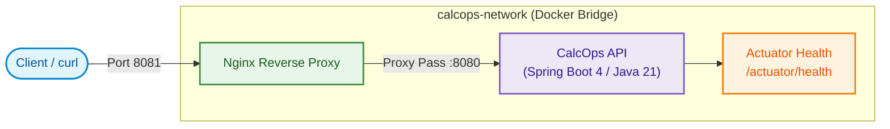

# CalcOps 🧮 🚀

A containerized RESTful Calculator API built with **Spring Boot 4**, **Java 21**, **Docker**, **Nginx**, and **Jenkins CI/CD**.

[](https://adoptium.net/)
[](https://spring.io/projects/spring-boot)
[](https://www.docker.com/)
[](https://nginx.org/)
[](https://www.jenkins.io/)

---

## 🏗️ Architecture



---

## 📖 API Documentation

All calculation endpoints are exposed under `/api/v1` and take two query parameters: `a` and `b`.

### Endpoints

| Method | Endpoint | Query Parameters | Description |
|---|---|---|---|
| `GET` | `/api/v1/add` | `a` (double), `b` (double) | Returns `a + b` |
| `GET` | `/api/v1/subtract` | `a` (double), `b` (double) | Returns `a - b` |
| `GET` | `/api/v1/multiply` | `a` (double), `b` (double) | Returns `a * b` |
| `GET` | `/api/v1/divide` | `a` (double), `b` (double) | Returns `a / b` |
| `GET` | `/actuator/health` | _None_ | Service health status |

### Response Formats

* **Success (`200 OK`)**:
  ```json
  {
    "operation": "add",
    "a": 10.0,
    "b": 25.0,
    "result": 35.0
  }
  ```

* **Error Responses (`400 Bad Request`)**:
  * **Division by Zero**: `{"error": "DIVISION_BY_ZERO", "message": "Cannot divide by zero"}`
  * **Missing Parameter**: `{"error": "MISSING_PARAMETER", "message": "Required parameter 'b' is missing"}`
  * **Invalid Parameter**: `{"error": "INVALID_PARAMETER", "message": "Parameter 'a' must contain a valid number"}`

---

## 🔨 Build

### 1. Build the Application (JAR)
Using the Maven wrapper:
```bash
./mvnw clean package -DskipTests
```
The packaged executable JAR will be located at `target/calcops-0.0.1-SNAPSHOT.jar`.

### 2. Build the Docker Image
Build the multi-stage production container:
```bash
docker build -t calcops:latest .
```

---

## 🧪 Test

Execute the full suite of unit and Spring MVC MockMvc integration tests:
```bash
./mvnw clean test
```
JUnit XML test reports are automatically generated at:
```text
target/surefire-reports/TEST-*.xml
```

---

## 🚀 Run

### Option 1: Run with Docker Compose (Recommended - Full Stack)
Starts both the CalcOps API and the Nginx reverse proxy on the isolated `calcops-network`:
```bash
docker-compose up -d
```
* API is exposed via Nginx on port **8081**.
* To check service status and health:
  ```bash
  docker compose ps
  ```
* To stop the services:
  ```bash
  docker compose down
  ```

### Option 2: Run Locally with Maven
Runs the Spring Boot app directly on port **8080**:
```bash
./mvnw spring-boot:run
```

### Option 3: Run with Docker (Standalone)
```bash
docker run -d -p 8080:8080 --name calcops calcops:latest
```

---

## 📡 Call the API

You can call the endpoints using `curl` or any HTTP client:

### Via Nginx Reverse Proxy (Port 8081)
```bash
# Add
curl "http://localhost:8081/api/v1/add?a=10&b=25"

# Subtract
curl "http://localhost:8081/api/v1/subtract?a=50&b=15"

# Multiply
curl "http://localhost:8081/api/v1/multiply?a=6&b=7"

# Divide
curl "http://localhost:8081/api/v1/divide?a=100&b=4"

# Division by Zero (Returns 400 Bad Request)
curl "http://localhost:8081/api/v1/divide?a=10&b=0"

# Actuator Health Check
curl "http://localhost:8081/actuator/health"
```

### Direct to Spring Boot (Port 8080)
If running locally via `./mvnw spring-boot:run` or standalone `docker run`:
```bash
curl "http://localhost:8080/api/v1/add?a=10&b=25"
curl "http://localhost:8080/actuator/health"
```
